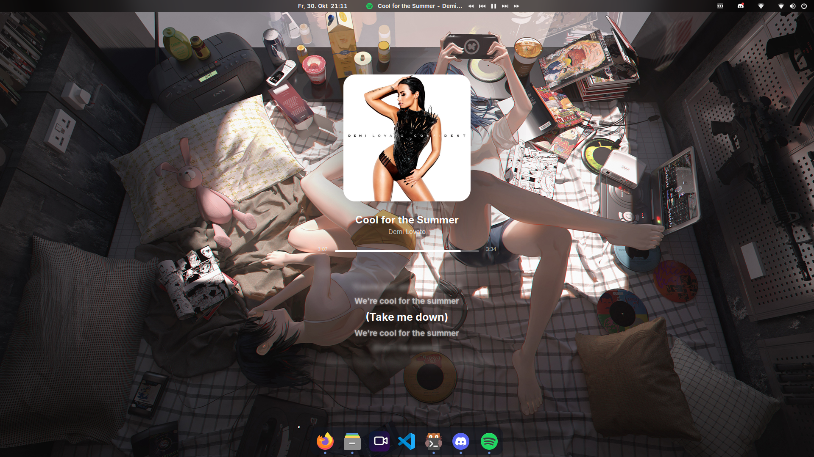

<div align="center">

# Eww Spotify Widget

Cover, title, progress bar and live synced lyrics for GNOME on Wayland.



</div>

## About

A small eww widget that shows what Spotify is playing: cover, title, progress and synced lyrics. No background, no gradient, no separators. Any MPRIS player works, Spotify is preferred.

Lyrics come from [LRCLIB](https://lrclib.net) and are cached locally. Lines further away from the current one are blurred with `text-shadow`. The only dependencies are `python3` and `python3-gi`.

## Requirements

GNOME's compositor (Mutter) has no layer-shell, so eww has to be built with the X11 backend and runs through XWayland.

```sh
sudo apt install -y git build-essential pkg-config libgtk-3-dev libpango1.0-dev \
  libgdk-pixbuf-2.0-dev libdbusmenu-gtk3-dev libcairo2-dev libglib2.0-dev libx11-dev python3-gi

curl --proto '=https' --tlsv1.2 -sSf https://sh.rustup.rs | sh -s -- -y && . "$HOME/.cargo/env"

git clone https://github.com/elkowar/eww ~/eww
cd ~/eww && cargo build --release --no-default-features --features x11
mkdir -p ~/.local/bin && cp target/release/eww ~/.local/bin/
```

## Install

```sh
git clone https://github.com/jellystream-app/eww-spotify-widget.git
cd eww-spotify-widget
sh install.sh
~/.config/eww-viper/start.sh
```

## Configuration

| Setting | Location |
|---|---|
| Position and size | `:geometry` in `eww-viper/eww.yuck` |
| Preferred player | `PREFER` in `scripts/music.py` |
| Lyrics timing | `LEAD` in `scripts/music.py` |
| Number of lyric lines | `ROWS` in `scripts/music.py` |
| Colors, fonts, blur | `eww-viper/eww.scss` |

Apply changes with `eww -c ~/.config/eww-viper reload`.

## Troubleshooting

| Problem | Fix |
|---|---|
| `eww: not found` | Make sure the binary is in `~/.local/bin`, `start.sh` adds it to the PATH |
| Window does not appear | Change `:windowtype "desktop"` to `"dock"` in `eww.yuck` |
| Nothing shows up | Check `eww -c ~/.config/eww-viper logs` |
| No lyrics | The track is not on LRCLIB |
| Real background blur | Add the window's `WM_CLASS` (`xprop WM_CLASS`) in the Blur my Shell extension under Applications |

## Notes

Lyrics and cover art are fetched at runtime from LRCLIB and Spotify. Nothing copyrighted is shipped in this repository.

## Deutsch

Minimalistisches eww-Widget für GNOME unter Wayland: Cover, Titel, Fortschrittsbalken und Live-Lyrics ohne Hintergrund. eww muss mit `--features x11` gebaut werden, da GNOME kein layer-shell hat. Installation mit `sh install.sh`, Start mit `~/.config/eww-viper/start.sh`. Position, Größe und Farben stehen in `eww.yuck` und `eww.scss`.

## License

MIT, see [LICENSE](LICENSE).
